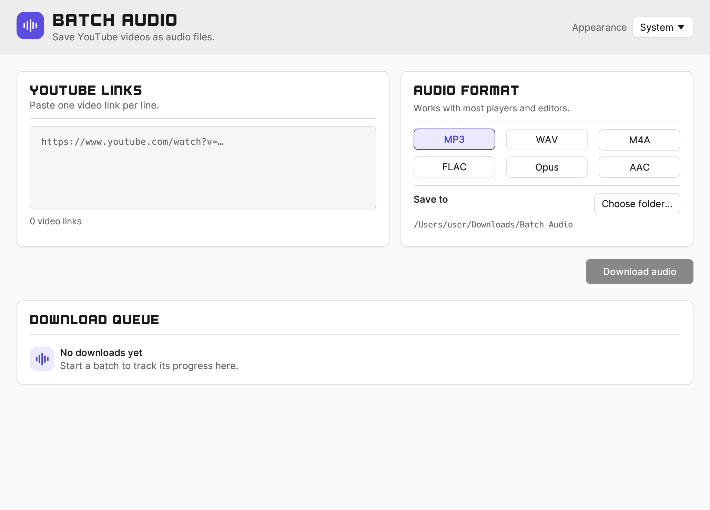

# Batch Audio

Batch Audio is a desktop app that saves audio from many YouTube links at once. It is written in Rust with [egui](https://github.com/emilk/egui) and uses [yt-dlp](https://github.com/yt-dlp/yt-dlp) for downloads.



## Features

- Paste many links at once, separated by spaces, new lines, or commas.
- Counts invalid links and skips duplicates.
- Saves as MP3, WAV, M4A, FLAC, Opus, or AAC.
- Downloads up to three files at once, starting them in list order.
- Shows the title, progress, and result of each download, including when it is converting.
- Keeps going when a download fails. Starting the same link again can resume it.
- Cancels a running batch, including every yt-dlp and FFmpeg process. Files that are already saved stay in the folder.
- Lets you choose the output folder. The default is `Downloads/Batch Audio` in your home folder.
- Light, dark, and system appearance.

It accepts `watch`, `shorts`, `live`, `embed`, and `v` links on `youtube.com`, `www.youtube.com`, `m.youtube.com`, and `music.youtube.com`, and short `youtu.be` links.

## Requirements

- [Rust](https://rustup.rs/), to build the app
- [yt-dlp](https://github.com/yt-dlp/yt-dlp/wiki/Installation)
- [FFmpeg](https://ffmpeg.org/download.html), including `ffprobe`
- A JavaScript runtime: [Deno](https://docs.deno.com/runtime/getting_started/installation/), Node.js, or Bun

On macOS with Homebrew:

```sh
brew install yt-dlp ffmpeg deno
```

## Run

```sh
git clone https://github.com/BothSann/bulk-yt.git
cd bulk-yt/app
cargo run --release
```

The app looks for the tools next to its own executable and on your `PATH`. On macOS and Linux it also checks common install folders such as `/opt/homebrew/bin` and `~/.local/bin`. If something is missing, **Set up downloads…** appears in the app and lists it.

## Limitations

- The window stays open until a running batch finishes or is cancelled.
- Playlists are not expanded.
- A failed download can leave a `.batch-audio-<video ID>` folder in the output folder, so that it can resume.

## Project layout

| Path | Purpose |
| --- | --- |
| `app/src/main.rs` | Command-line arguments and startup |
| `app/src/app.rs` | App state and actions |
| `app/src/ui` | Window layout, panels, and shared widgets |
| `app/src/theme.rs` | Colors, fonts, and egui styling |
| `app/src/screenshot.rs` | The `--screenshot` option |
| `app/src/queue.rs` | Download queue and background workers |
| `app/src/cancel.rs` | Stopping a batch and its processes |
| `app/src/downloader.rs` | Tool detection and yt-dlp |
| `app/src/links.rs` | Link parsing |
| `app/src/format.rs` | Audio formats |
| `app/assets/fonts` | Bundled fonts. Inter is under the SIL Open Font License. |

Dependencies point one way: `ui` → `app` → `queue` → `downloader`. `queue`, `downloader`, `links`, and `format` do not import egui or eframe, so their tests need no window.

## Development

Run these in `app`. CI runs the first three on macOS, Windows, and Linux for every pull request to `main`.

```sh
cargo fmt --check
cargo clippy --locked --all-targets -- -D warnings
cargo test --locked
cargo run -- --screenshot ../docs/screenshot.png
```

The last command saves an image of the main window and quits. Tests use a fake downloader and do not connect to YouTube.

## Responsible use

Download only content that you own or have permission to save. You are responsible for following YouTube's terms and the copyright law that applies to you.
